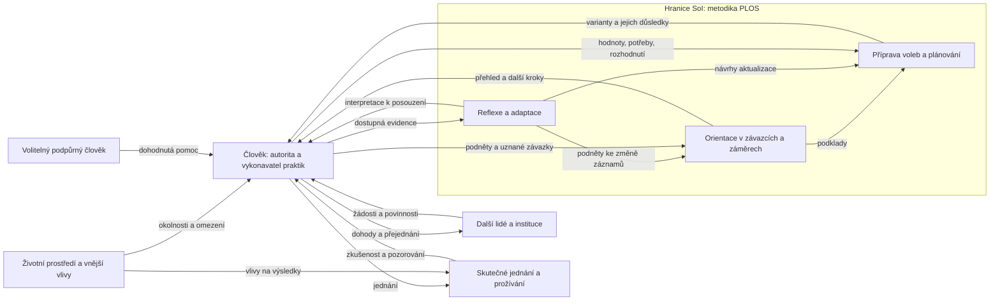

# DG-01 — System Context Diagram

**Účel:** vymezit System-of-Interest a dvojí roli člověka jako rozhodovací autority a vykonavatele praktik. **Dokumentace:** [CH-01](../01-foundations/system-charter.md), [ADR-01](../05-decisions/decision-log.md#adr-01--hybridní-architektura-funkčních-odpovědností).

## Zdrojová definice

## Prvky a vztahy

Uvnitř hranice jsou skupiny funkcí metodiky, nikoli úplné členění na SS. Člověk funkce vykonává, ale zůstává jako osoba mimo SoI. Šipky označují pojmenované interakce; nevyjadřují automatizaci ani kontrolu druhých lidí. Dohoda s protistranou a její následky vznikají mimo PLOS, který drží jejich rozpoznanou reprezentaci.

## Předpoklady a omezení

[ASM-01](../01-foundations/system-charter.md#předpoklady-a-omezení) až [ASM-04](../01-foundations/system-charter.md#předpoklady-a-omezení); model nezobrazuje všechny stakeholdery jednotlivě. Podpůrná role nemá automatický přístup k záznamům. Budoucí software není zakreslen, protože není součástí současné systémové hranice. „Skutečné jednání“ není technický regulovaný objekt.
