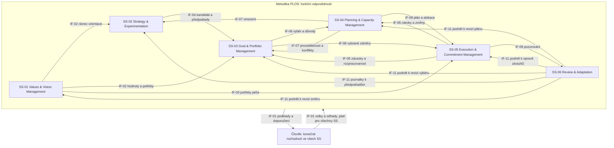

# DG-02 — High-Level Functional Architecture

**Účel:** ukázat vlastníky funkcí a hlavní informační vazby. **Dokumentace:** [ARCH-01](../03-architecture/conceptual-architecture.md), [REQ-01](../02-requirements/high-level-requirements.md).

## Zdrojová definice

## Prvky a vztahy

Každý SS odpovídá stejnojmenné kapitole ARCH-01. Hrany jsou hlavní informační předání, nikoli časové pořadí. IF-11 znamená podnět, který se stává změnou až rozhodnutím člověka. Hrana k rámečku PLOS je souhrnná zkratka vztahu člověka se všemi SS.

## Předpoklady a omezení

Pro čitelnost není rozkreslen IF-10: každý SS poskytuje SS-06 platné reference a důvody. Okolí a IF-12 jsou v DG-01. Model není fyzickou dekompozicí do šesti aplikací ani šesti organizací. Vlastnictví konkrétních významů, rozsah invariantů a řešení překryvů jsou normativně vysvětleny v ARCH-01, nikoli geometrickou polohou uzlů.
