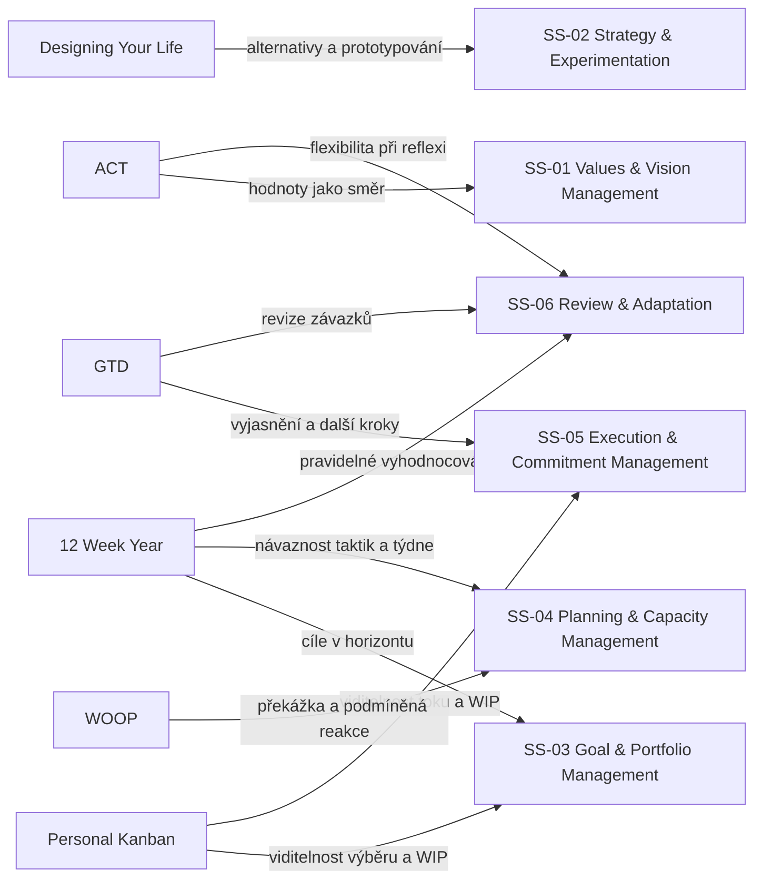

# DG-03 — Framework Responsibility Map

**Účel:** zviditelnit původ metodických příspěvků a jejich přidělení funkčním odpovědnostem. **Dokumentace:** [FW-01 se zdroji a omezeními](../03-architecture/framework-integration.md), [ADR-01 až ADR-05](../05-decisions/decision-log.md).

## Zdrojová definice

## Prvky a vztahy

Levé uzly jsou zdrojové frameworky, pravé logické SS. Šipka znamená **příspěvek použitý v návrhu PLOS**. Nepředstavuje závislost programu, výlučnou kompetenci frameworku ani tvrzení o úplné implementaci jeho původní podoby. Přidělení je rozhodnutí PLOS; zdrojové principy jsou doloženy v FW-01.

## Předpoklady a omezení

Mapování nezobrazuje obecné SE/MBSE postupy, které jsou metodou návrhu celého systému. ACT ani GTD se původně neomezují jen na zde přidělené funkce. WOOP má i zkušenostní složku; samotný plán reakce ji nenahrazuje. H-01 až H-05 zůstávají neověřené.
