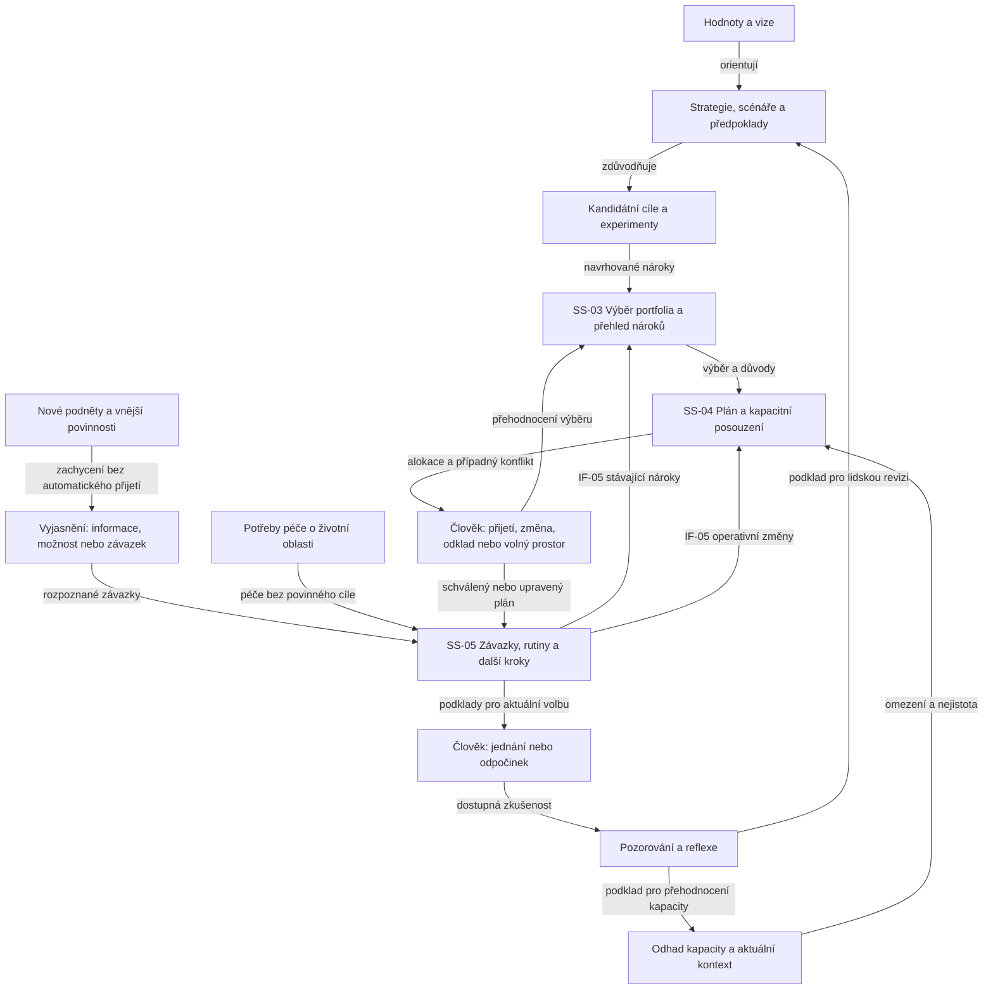

# DG-04 — Strategic-to-Operational Information Flow

**Účel:** ukázat převod směru k jednání a stejně legitimní vstup průběžné péče a povinností. **Dokumentace:** [ARCH-01](../03-architecture/conceptual-architecture.md), [DOM-01](../03-architecture/preliminary-domain-model.md), [UC-01 až UC-06](../01-foundations/concept-of-operations.md).

## Zdrojová definice

## Prvky a vztahy

Hrany označují předání významu a informace, nikoli povinný workflow. Již existující závazek může být rozpoznán přímo v operativě; významné nároky se vracejí do společného posouzení. Konkrétní Project může organizovat provádění cíle nebo experimentu uvnitř [SS-05](../03-architecture/conceptual-architecture.md#ss-05--execution--commitment-management); uzel zde není zvlášť kvůli čitelnosti.

## Předpoklady a omezení

Není nutné projít všechny horní uzly před běžným jednáním. Rozhodovací uzel zvýrazňuje konflikt kapacity, ale konečná autorita člověka platí i jinde. Rutina bez cíle a volný prostor jsou validní cesty. Reflexe může vracet podnět i k hodnotám, jak ukazuje [DG-05](README.md#dg-05); diagram není úplný graf všech zpětných vazeb.
