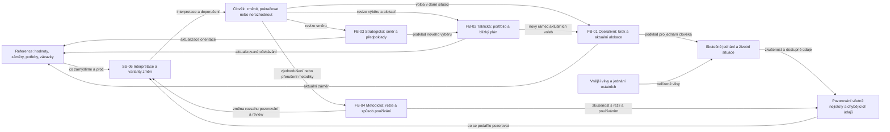

# DG-05 — Feedback Control Architecture

**Účel:** vyjádřit několik horizontů učení a lidskou autoritu mezi doporučením a změnou. **Dokumentace:** [FB-01 až FB-04 v ARCH-01](../03-architecture/conceptual-architecture.md), [OP-06/07](../01-foundations/concept-of-operations.md), [ADR-03/05](../05-decisions/decision-log.md).

## Zdrojová definice

## Prvky a vztahy

Reference nejsou jediný číselný setpoint. Pozorování je omezené a interpretace není kauzální důkaz. FB-01, FB-02 a FB-03 mění odlišné objekty; FB-04 mění způsob používání metodiky. Všechny cesty od doporučení ke změně vedou přes člověka. Rytmy jsou v ARCH-01; událost může vyvolat revizi kdykoli.

## Předpoklady a omezení

Vliv volby na život je částečný a nejistý. Nezobrazuje se přenosová funkce, veličiny regulátoru ani důkaz stability. Model neznamená, že smyčky vždy proběhnou nebo že každé pozorování vyvolá změnu. Zpoždění účinků a riziko nadměrného přeplánování zůstávají OQ-02/OQ-05 a R-06.
