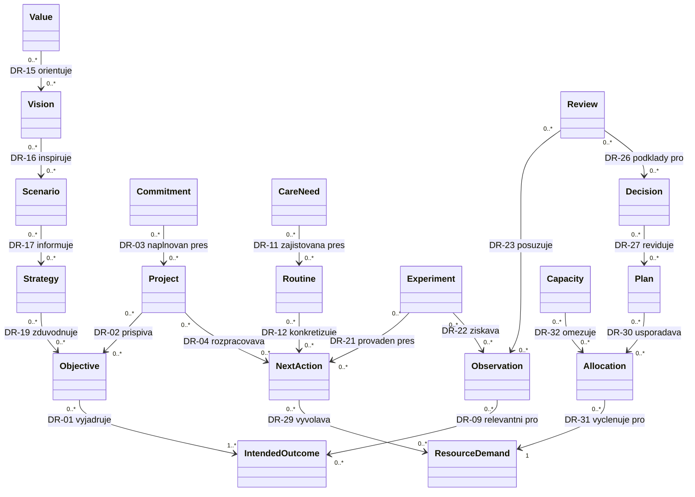

# DG-06 — Domain Architecture: celkový pohled

**Verze:** 0.2 • **Notace:** konceptuální UML class diagram, textový zápis Mermaid `classDiagram`. **Účel:** propojit čtyři doménové skupiny bez povinného stromu strategie. Definice [GLO-01](../glossary.md), vztahy a invarianty [DOM-01](../03-architecture/preliminary-domain-model.md). Pravidla notace a validace: [index](README.md). ADR-11 nahrazuje původní flowchart DG-06; ID pohledu zůstává.

Třídy zde klasifikují významy, nikoli programové objekty. Asociace se šipkou je navigovatelná ve směru čtení popisku, ne tok práce. Obě násobnosti jsou explicitní; číslo u konce říká počet instancí na tomto konci pro jednu instanci na opačném. Všechny asociace jsou referenční, žádná kompozice. Celkový pohled ukazuje hlavní spojení; úplný katalog včetně volitelných a odvozených konceptů je DOM-01, detailní pohledy DG-07 až DG-10.

## Zdrojová definice

## Výklad a omezení

Cesta Project → Objective není povinná. Care Need, Routine a Commitment mají samostatnou legitimitu. Stejný Next Action i nárok se může objevovat ve více pohledech se zachovanou identitou. Intended Outcome je obsah bez samostatné kontinuity; Observed Outcome je role Observation (není zakreslen jako další nezávislá třída). Násobnost 1..* u Intended Outcome vyjadřuje významovou nutnost obsahu cíle, nikoli počet povinných záznamů. Neúplně známé vazby se neposuzují jako prokázaná nula.

Invariance a podmínky, které UML asociace nevyjadřují (zejména INV-04/05/06/14/15), platí podle DOM-01. Nejde o spustitelný model, databázové schéma, úplný UML metamodel ani strojový důkaz konzistence.
