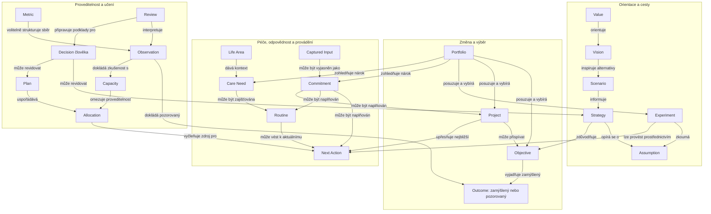

# DG-06 — Preliminary Domain Concept Diagram

**Účel:** ukázat reprezentativní významové vztahy hlavních konceptů. **Dokumentace:** [DOM-01](../03-architecture/preliminary-domain-model.md), [GLO-01](../glossary.md), [ADR-06](../05-decisions/decision-log.md#adr-06--lehký-konceptuální-model-a-textové-diagramy).

## Zdrojová definice

## Prvky a vztahy

Uzly jsou pojmy, nikoli třídy nebo tabulky. Šipky se čtou podle popisků a nejsou časovým tokem. „Může“ znamená přípustnou vazbu, nikoli povinnost nebo stanovenou kardinalitu. Outcome je zobrazen jedním konceptem s rozlišeným použitím, ne sloučením očekávání a evidence. Základní rozdíly rozvádí DOM-01.

## Předpoklady a omezení

Kvůli čitelnosti nejsou zakresleny Personal Principle a Conditional Response ani všechny vazby alokací, experimentů a rozhodnutí; jsou popsány v DOM-01. Habit a Output jsou rozlišovací pojmy bez povinné samostatné evidence. Neexistuje předpoklad, že každý krok má cíl nebo projekt. Kardinality, detailní invarianty, atributy a stavy tento model nezachycuje.
