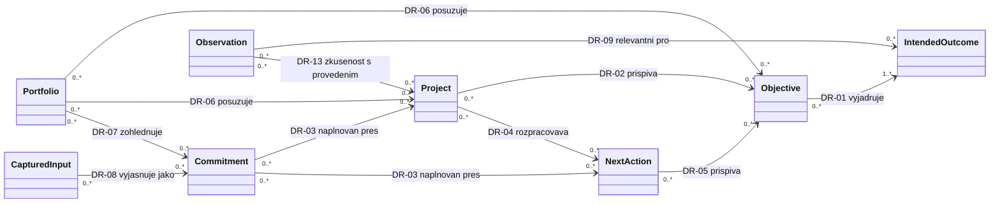

# DG-07 — Goals, Projects & Commitments

**Verze:** 0.2 • **Notace:** konceptuální UML class diagram v Mermaid. **Účel:** identita práce, odpovědnosti a výsledku, vztahy mnoho–mnoho. Autorita: [DOM-01, C1](../03-architecture/preliminary-domain-model.md), [GLO-01](../glossary.md). Legenda a validace: [index](README.md).

## Zdrojová definice

## Výklad a omezení

Asociace a jejich násobnosti mají pravidla [DG-06](README.md#dg-06); šipky nejsou postupem přijímání závazků. Portfolio odkazuje na stejné koncepty. Commitment může mít nula projektů a několik kroků, Project může mít několik cílů a žádný závazek. Dokončený Project nemění automaticky posouzení Intended Outcome. Pozorování účinku hraje roli Observed Outcome; pozorování dokončení práce dokládá Output. Nejde o dva nové objekty vznikající z každého pozorování.

Podmínky identity a revizí: [INV-02](../03-architecture/preliminary-domain-model.md#katalog-invariantů) až [INV-06](../03-architecture/preliminary-domain-model.md#katalog-invariantů), [INV-18](../03-architecture/preliminary-domain-model.md#katalog-invariantů). Vazba Commitment → Routine je pro čitelnost v [DG-08](README.md#dg-08). Případy [SV-01](../07-review/semantic-validation-report.md#cílené-sv-01-až-sv-10)/02/06/09/10 v [sémantické verifikaci](../07-review/semantic-validation-report.md).
