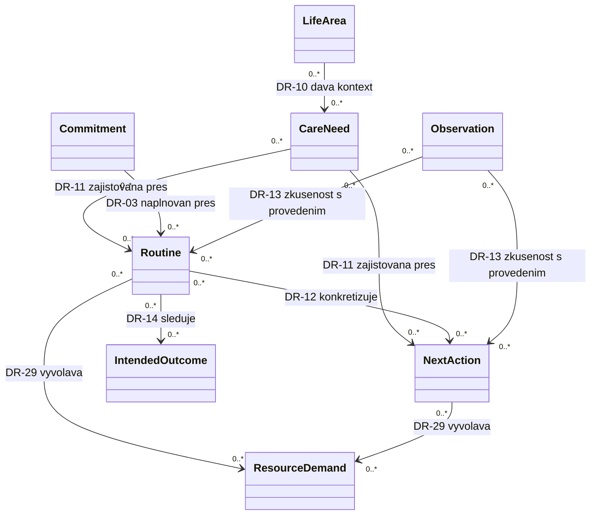

# DG-08 — Life Areas, Care & Routines

**Verze:** 0.2 • **Notace:** konceptuální UML class diagram v Mermaid. **Účel:** péče, opakovaný záměr a konkrétní provedení bez povinného projektu. Autorita: [DOM-01, C2](../03-architecture/preliminary-domain-model.md), [GLO-01](../glossary.md). Legenda a validace: [index](README.md).

## Zdrojová definice

## Výklad a omezení

Oblast může být bez potřeby explicitně rozpoznané v modelu a bez aktivního projektu; péče může být rozpoznána bez pojmenované oblasti. Routine může být přerušena a stále existovat; její konkrétní provedení není samotná rutina. Habit je odvozený výklad Observation, nikoli podtřída Routine nebo automatický důsledek opakování. Proto nemá vlastní asociaci vytvářející novou identitu. Rozklad běhu rutiny není povinnou evidencí všech výskytů.

Nároky rutiny a jejích kroků mohou pokrývat stejnou práci; jejich současná přítomnost neopravňuje součet (INV-14/15). Další pravidla INV-06/07/08; případy UC-02/04 a SV-04/07. Žádná hrana neimplikuje zajištění péče či vykonání činnosti.
