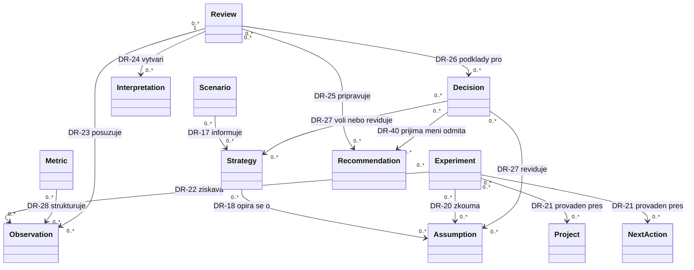

# DG-09 — Strategy, Assumptions & Experiments

**Verze:** 0.2 • **Notace:** konceptuální UML class diagram v Mermaid. **Účel:** rozlišit alternativu, poznávací pokus, zkušenost, výklad a volbu. Autorita: [DOM-01, C3](../03-architecture/preliminary-domain-model.md), [GLO-01](../glossary.md). Legenda a validace: [index](README.md).

## Zdrojová definice

## Výklad a omezení

Interpretation je obsah odvozený při jednom původním Review, nikoli autonomní evidence či nová událost. Kandidátní a přijatá Strategy jsou rozlišeny lidskou volbou, ne dědičností. Assumption je volitelná vazba Experiment pouze proto, že pokus smí mít místo tvrzení poznávací otázku; samotný experiment bez otázky i předpokladu je neplatný (INV-09).

Nerozhodný nebo prázdný poznatek nebrání ukončení pokusu. Doporučení není rozhodnutí, rozhodnutí nevyžaduje předchozí review. Vazby Value/Vision jsou v DG-06, vazby WOOP a jejich odvozené role v DOM-01; diagram nenahrazuje celý proces frameworku. INV-02/06/09/10/17/18; UC-01/05/06/07 a SV-05/06.
