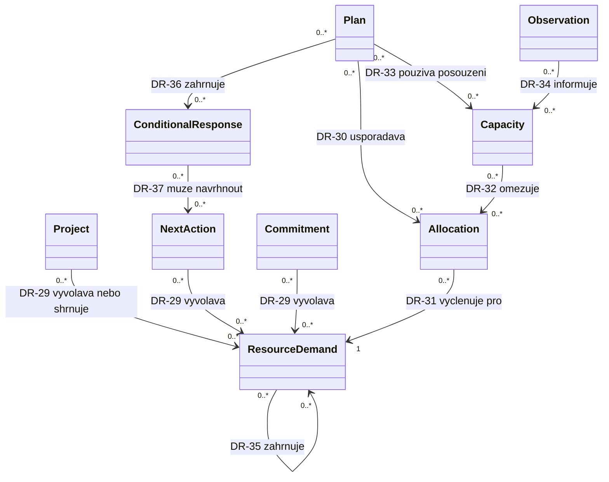

# DG-10 — Capacity, Allocation & Planning

**Verze:** 0.2 • **Notace:** konceptuální UML class diagram v Mermaid. **Účel:** dostupnost, nárok a alokace se sdíleným rozsahem práce. Autorita: [DOM-01, C4](../03-architecture/preliminary-domain-model.md), [GLO-01](../glossary.md). Legenda a validace: [index](README.md).

## Zdrojová definice

## Výklad a omezení

Resource Demand je obsah odhadu pro vymezený rozsah, ne další samostatná identita práce. Reflexivně zakreslená asociace [DR-35](../03-architecture/preliminary-domain-model.md#katalog-vztahů) spojuje **různé** nároky; na úrovni instancí je nereflexivní a bez cyklů. Není UML kompozicí: stejná část může být zohledněna v několika souhrnech. Před součtem se řeší překryv.

Planned Capacity a Actual Capacity jsou role posouzení Capacity, nikoli dvě nezávislé zásoby. Není mezi nimi automatický převod. Observation o spotřebě je jiný podklad než posouzení dostupnosti. Každá Allocation se týká právě jednoho vymezeného, případně souhrnného nároku a jednoho zdroje; více zdrojů znamená více rozlišených vyčlenění. Širší a dílčí Plan mohou referovat totéž vyčlenění bez zdvojení.

Další zdroje nároků a WOOP vazby viz [DR-29](../03-architecture/preliminary-domain-model.md#katalog-vztahů)/38 v [DOM-01](../03-architecture/preliminary-domain-model.md); každý zde zobrazený nárok podléhá [INV-11](../03-architecture/preliminary-domain-model.md#katalog-invariantů) až [INV-16](../03-architecture/preliminary-domain-model.md#katalog-invariantů). [SV-03](../07-review/semantic-validation-report.md#cílené-sv-01-až-sv-10)/08/10/11 kontrolují souhrn/detail, skutečný konflikt, sdílenou práci a částečný překryv. Diagram neurčuje číselný model ani prioritizaci.
