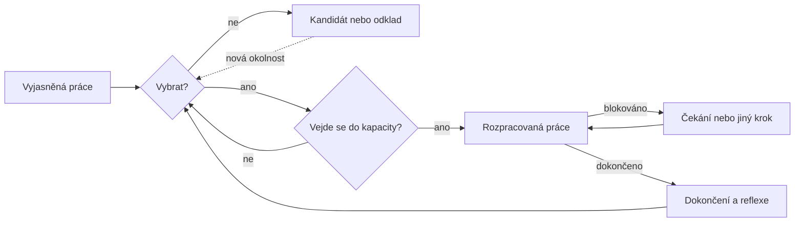

# Řízení rozpracované práce

**Co tím vyřešíte:** rozhodnete, na čem pracovat, co nechat běžet nebo čekat a kdy zahájit novou práci. **Kdy:** na začátku dne, po dokončení větší věci a při přetížení. **Vstupy:** co už běží, závazky s termínem nebo dopadem na druhé, vybrané záměry, odhad kapacity. **Předpoklady:** tabule ani aplikace nejsou potřeba; zápis je volitelný.

## Kdy postup použít

Použijte ho, když se rozhodnutí mezi pracemi opakuje, když se hromadí zahájené věci, nebo když není jasné, zda začínat něco nového. Nový podnět nejprve vyjasněte podle [zpracování nového podnětu](process-input.md).

## Postup

1. **Posuďte, co už běží (2 minuty).** Vyjmenujte práci, kterou jste skutečně zahájili a dosud neuzavřeli. Nevybraný kandidát, nápad ani nezávazné čekání na informaci se nepočítají. Všimněte si, která z nich dnes vyžaduje pozornost.
2. **Vyberte práci (2 minuty).** Nejdřív to, co plyne z existujícího závazku nebo povinnosti. Potom to, co podporuje vybraný strategický záměr. Potom to, co je smysluplné a proveditelné i bez závazku a projektu. Strategie sama nepřeváží povinnost a naléhavost sama není důvodem; volba musí být vědomá.
3. **Ověřte kapacitu (1 minuta).** Porovnejte nárok vybrané práce s dostupností. Když se nevejde, rozhodněte předem: zmenšit rozsah, odložit, přejednat s dotčeným člověkem, nebo přiznat nevyřešený konflikt. Priorita ani strategie kapacitu nepřidají.
4. **Zahajte, pokračujte, přerušte nebo dokončete.** Zahájení znamená, že práci věnujete pozornost. Pokračování je nová volba, ne setrvačnost. Přerušení pojmenujte jako odklad s podmínkou návratu, nebo jako blokaci. Dokončení se týká rozsahu práce, ne zamýšleného výsledku.
5. **Uzavřete smyčku (1 minuta).** Dokončená nebo uvolněná práce přestává zabírat pozornost. Uvolněte ji vědomě a rozhodněte, co dostane prostor.

Obrázek 1 — Pracovní tok od vyjasněné práce k dokončení. Zobrazuje volbu, ověření kapacity, blokaci a návrat k výběru. Nepojmenovává sloupce tabule ani neukládá povinné pořadí.

## Čekání a blokování

Když práce nemůže pokračovat, napište, na co čekáte a podle čeho poznáte návrat. U závazku odpovědnost trvá; u dobrovolné práce se rozhodněte, zda čekání stojí za pozornost. Blokovaná práce není dokončená. Hledejte jiný další krok, který na překážce nezávisí, nebo práci vědomě uvolněte.

## Očekávaný výsledek

- vědomá volba: pokračovat, začít, odložit, uvolnit, nebo dokončit,
- pojmenovaná práce, která zůstává rozpracovaná,
- rozhodnutí o kapacitě s důvodem,
- čekání a blokace s podmínkou návratu.

## Když jste přetíženi

Nezvyšujte úsilí a nepřidávejte práci. Vyberte jednu věc, která nesmí minout, ostatní vědomě odložte. Uvolněte nebo zmenšete alespoň jednu rozpracovanou věc, i když výsledek bude menší, než jste chtěli. Když konflikt nejde vyřešit, pojmenujte ho a rozhodněte, co zůstane nevyřešené.

## Související

- [Denní rozhodování](daily-review.md) — dnešní volba mezi pokračováním a novou prací.
- [Týdenní plánování](weekly-planning.md) — výběr záměrů vedle běžící práce.
- [Výběr práce a WIP](../reference/work-selection-and-wip.md) — pravidla, meze a vztah ke kapacitě.
- [Podněty, závazky a další kroky](../reference/commitment-workflow.md) — co znamená čekání a závazek.
