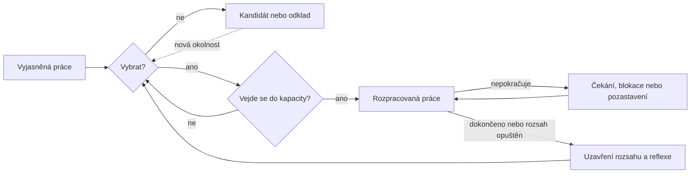

# Řízení rozpracované práce

**Co tím vyřešíte:** rozhodnete, na čem pracovat, co nechat běžet nebo čekat a kdy zahájit novou práci. **Kdy:** na začátku dne, po dokončení větší věci a při přetížení. **Vstupy:** co už běží, závazky s termínem nebo dopadem na druhé, vybrané záměry, odhad kapacity. **Předpoklady:** tabule ani aplikace nejsou potřeba; zápis je volitelný.

## Kdy postup použít

Použijte ho, když se rozhodnutí mezi pracemi opakuje, když se hromadí zahájené věci, nebo když není jasné, zda začínat něco nového. Nový podnět nejprve vyjasněte podle [zpracování nového podnětu](process-input.md).

## Postup

1. **Posuďte, co už běží (2 minuty).** Vyjmenujte práci, kterou jste skutečně zahájili a dosud neukončili. Nevybraný kandidát, nápad ani nezávazné čekání na informaci se nepočítají. Odpovězte odděleně na dvě otázky: kolik práce je zahájené a dosud neukončené, a která z ní právě vyžaduje aktivní pozornost nebo alokaci. Pozastavená práce může uvolnit bezprostřední kapacitu, ale zůstává zahájená; pouhé pozastavení není dokončení.
2. **Zvolte práci (2 minuty).** Rozhodněte podle situace, ne podle pevného pořadí. Zvažte závaznost (co skutečně platí), naléhavost (blízký termín nebo bezprostřední důsledky), důležitost (hodnoty, potřeby péče a vybrané výsledky), proveditelnost, rozpracovanost (co už běží) a regeneraci (co potřebujete pro únosnou kapacitu). Závazek je omezení a odpovědnost, ne automaticky absolutní priorita každého dne. Strategický záměr nemá automatickou přednost, ale ani každý závazek nevyžaduje dnešní aktivitu. Když se hlediska rozcházejí, pojmenujte konflikt a rozhodněte vědomě; bodování ani univerzální pořadí volbu nenahrazují.
3. **Ověřte kapacitu (1 minuta).** Porovnejte zdrojový nárok vybrané práce s dostupností. Když se nevejde, rozhodněte předem: zmenšit rozsah, odložit, přejednat s dotčeným člověkem, nebo přiznat nevyřešený konflikt. Priorita ani strategie kapacitu nepřidají.
4. **Zahajte, pokračujte, pozastavte, opusťte nebo dokončete.** Zahájení znamená, že práci věnujete pozornost. Pokračování je nová volba, ne setrvačnost. Pozastavení nebo blokaci pojmenujte jako odklad s podmínkou návratu; práce zůstává zahájená a neukončená. Vědomé opuštění rozsahu je samostatné rozhodnutí, ne dokončení; závazek vůči jinému člověku tím nezaniká. Dokončení se týká rozsahu práce, ne zamýšleného výsledku.
5. **Uzavřete smyčku (1 minuta).** Dokončená práce nebo práce, jejíž rozsah jste vědomě opustili, přestává být rozpracovaná. Pozastavená práce uvolní pozornost, ale zůstává zahájená a neukončená; závazek, který k ní patří, trvá bez ohledu na pozastavení projektu. Uvolněte pozornost vědomě a rozhodněte, co dostane prostor.

Obrázek 1 — Pracovní tok od vyjasněné práce k dokončení. Zobrazuje volbu, ověření kapacity, blokaci či pozastavení a návrat k výběru. Pozastavená práce se vrací do rozpracované práce, ne k dokončení. Diagram nepojmenovává sloupce tabule ani neukládá povinné pořadí.

## Čekání a blokování

Když práce nemůže pokračovat, napište, na co čekáte a podle čeho poznáte návrat. U závazku odpovědnost trvá; u dobrovolné práce se rozhodněte, zda čekání stojí za pozornost. Blokovaná ani pozastavená práce není dokončená. Hledejte jiný další krok, který na překážce nezávisí, nebo práci vědomě opusťte; samotné pozastavení rozsah neukončuje.

## Očekávaný výsledek

- vědomá volba: pokračovat, začít, pozastavit, opustit, nebo dokončit,
- pojmenovaná práce, která zůstává rozpracovaná, i když právě nevyžaduje pozornost,
- rozhodnutí o kapacitě s důvodem,
- čekání a blokace s podmínkou návratu.

## Když jste přetíženi

Nezvyšujte úsilí a nepřidávejte práci. Vyberte jednu věc, která nesmí minout, ostatní vědomě odložte. Snižte počet věcí, které právě vyžadují pozornost: alespoň jednu rozpracovanou věc pozastavte, zmenšete její rozsah nebo její rozsah vědomě opusťte, i když výsledek bude menší, než jste chtěli. Pozastavení uvolní bezprostřední kapacitu, ale celkovou rozpracovanost samo nesníží. Když konflikt nejde vyřešit, pojmenujte ho a rozhodněte, co zůstane nevyřešené.

## Související

- [Denní rozhodování](daily-review.md) — dnešní volba mezi pokračováním a novou prací.
- [Týdenní plánování](weekly-planning.md) — výběr záměrů vedle běžící práce.
- [Výběr práce a WIP](../reference/work-selection-and-wip.md) — pravidla, meze a vztah ke kapacitě.
- [Podněty, závazky a další kroky](../reference/commitment-workflow.md) — co znamená čekání a závazek.
