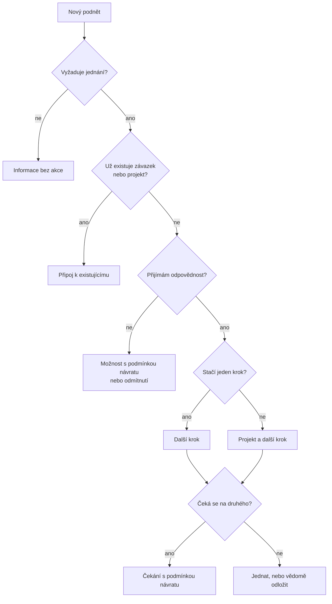

# Zpracování nového podnětu

**Co tím vyřešíte:** rozhodnete, co znamená nová informace, žádost, nápad nebo povinnost. **Kdy:** když podnět přijde; obvykle 2–5 minut. Zachycení práci nepřerušuje a vyjasnění nemusí být okamžité. **Vstupy:** podnět, co o něm víte, odhad kapacity. **Předpoklady:** aplikace ani formulář nejsou potřeba; zápis je volitelný.

## Postup

1. **Pojmenujte podnět jednou větou.** Co to je, od koho přišlo a proč to řešíte? Nevyjasněný podnět (Captured Input) není závazek (Commitment).
2. **Zjistěte, zda vyžaduje jednání.** Informace, oznámení nebo inspirace bez požadavku jednání nevyžadují. Uzavřete je nebo uložte k pozdějšímu použití.
3. **Ověřte, zda už závazek nebo projekt existuje.** Komu jste co slíbili a co už běží? Když ano, připojte podnět k existující věci; nový záznam vytvoří duplicitní práci nebo závazek ([INV-03](../../03-architecture/preliminary-domain-model.md#katalog-invariantů)/15).
4. **Rozhodněte, zda přijímáte odpovědnost.** Žádost, doporučení ani zápis závazek nevytváří ([INV-02](../../03-architecture/preliminary-domain-model.md#katalog-invariantů)). Závazek vzniká přijetím odpovědnosti nebo existující povinností — slibem, rolí, dohodou. Když odpovědnost nepřijmete, jde o nezávaznou možnost s podmínkou návratu, nebo o odmítnutou žádost.
5. **Určete cestu.** Když stačí jedna činnost, určete další krok (Next Action): co, kdy a za jakých podmínek. Když je potřeba sladit víc kroků, závislostí nebo lidí, jde o projekt (Project). Projekt i závazek mohou existovat samostatně ([INV-07](../../03-architecture/preliminary-domain-model.md#katalog-invariantů)).
6. **Ověřte, zda lze jednat nyní.** Když ano, začněte. Když ne, rozhodněte o odkladu s podmínkou, přejednání nebo odmítnutí.
7. **Pojmenujte čekání a podmínku návratu.** Když jednání závisí na druhém člověku nebo vnější události, řekněte, na co čekáte a podle čeho poznáte čas návratu. U čekání, odkladu i možnosti napište, kdy se k věci vrátíte. Čekání není dokončení a odpovědnost trvá.

Obrázek 1 — Rozhodovací strom pro nový podnět. Zobrazuje pořadí otázek, ne povinný záznam ani automatické řízení. U existujícího závazku řešíte jeho naplnění, ne vznik nového.

## Když je kapacita nízká

Nerozhodujte o všem. Vyberte jednu věc: podnět jen zachyťte a vyjasněte později, udělejte nejmenší další krok, nebo odpovězte, že nyní nemůžete. Odmítnutí i odklad jsou platné volby. Nevyjasněný podnět patří do nejbližší reflexe, ne do dnešního plánu.

## Příklad

Kolegyně se ptá, zda do pátku připravíte podklady pro její prezentaci. Nic takového jste jí neslíbili. Při současné kapacitě odpovíte, že to nestihnete, a nabídnete kratší rozsah. Žádost se uzavírá a závazek nevznikl. Kdybyste kratší rozsah přijali, vznikl by závazek s termínem a jedním dalším krokem.

## Očekávaný výsledek

- jeden výsledek: informace, možnost, existující nebo nový závazek, projekt, další krok, čekání, nebo odmítnutí,
- u závazku předmět, původ a podmínka splnění či zániku, i částečná,
- další krok nebo čekání s podmínkou návratu,
- vědomé rozhodnutí, co se kvůli podnětu mění — často nic.

## Když to nefunguje

- **Nevíte, co podnět znamená:** zeptejte se odesílatele. Neúplná informace je přípustná; neznámý stav není splnění ani zrušení ([INV-11](../../03-architecture/preliminary-domain-model.md#katalog-invariantů)).
- **Podnětů je mnoho:** vyjasněte je najednou v krátkém bloku, ne každý okamžitě.
- **Závazek se nedá splnit:** navrhněte změnu dotčenému člověku. Změna plánu sama závazek neruší ([INV-06](../../03-architecture/preliminary-domain-model.md#katalog-invariantů)).
- **Podnět je strategická možnost:** jde do portfolia jako kandidát, ne do dnešní práce.

## Související

- [Denní rozhodování](daily-review.md) — jak podnět zapadne do dne.
- [Týdenní plánování](weekly-planning.md) — kde se vyjasňují otevřené podněty a kapacita.
- [Podněty, závazky a další kroky](../reference/commitment-workflow.md) — přesná pravidla a invarianty.
