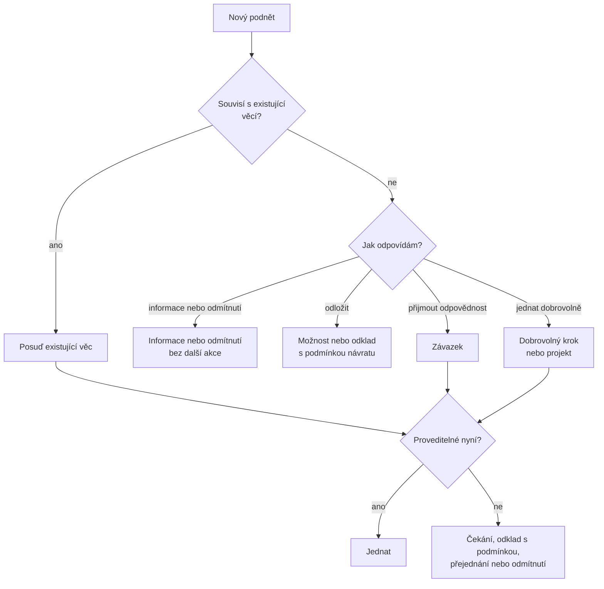

# Zpracování nového podnětu

**Co tím vyřešíte:** rozhodnete, co znamená nová informace, žádost, nápad nebo povinnost. **Kdy:** když podnět přijde; obvykle 2–5 minut. Zachycení práci nepřerušuje a vyjasnění nemusí být okamžité. **Vstupy:** podnět, co o něm víte, odhad kapacity. **Předpoklady:** aplikace ani formulář nejsou potřeba; zápis je volitelný.

## Postup

1. **Pojmenujte podnět jednou větou.** Co to je, od koho přišlo a proč to řešíte? Nevyjasněný podnět (Captured Input) není závazek (Commitment).
2. **Zjistěte, zda vyžaduje jednání.** Informace, oznámení nebo inspirace bez požadavku jednání nevyžadují. Uzavřete je nebo uložte k pozdějšímu použití.
3. **Ověřte, zda už věc existuje.** Komu jste co slíbili a co už běží? Když podnět souvisí s existujícím závazkem, projektem nebo krokem, připojte ho k téže věci a posuďte, co se změnilo: potřebujete nový další krok, čekáte na vnější událost, mění se plán, roste nárok na kapacitu, nebo je věc dokončená. Novou identitu ani druhou instanci práce nevytvářejte; otázky shrnuje [Podněty, závazky a další kroky](../reference/commitment-workflow.md#co-mění-nový-podnět-u-existující-věci).
4. **Rozhodněte, jak odpovídáte.** Máte pět možností: informace bez akce, odmítnutí (záležitost tím končí), odložení s podmínkou návratu, přijetí odpovědnosti (závazek), nebo dobrovolné jednání bez závazku. Přijetí závazku není podmínkou jednání. Žádost ani doporučení závazek nevytváří ([INV-02](../../03-architecture/preliminary-domain-model.md#katalog-invariantů)), ale smysluplnou činnost můžete udělat i bez něj.
5. **Určete cestu.** Když stačí jedna činnost, určete další krok (Next Action): co, kdy a za jakých podmínek. Když je potřeba sladit víc kroků, závislostí nebo lidí, jde o projekt (Project). Projekt může existovat bez závazku, závazek bez projektu a povinnost bez formálního projektu ([INV-07](../../03-architecture/preliminary-domain-model.md#katalog-invariantů)).
6. **Ověřte, zda lze jednat nyní.** Porovnejte nárok s dostupností. Když ano, začněte. Když ne, rozhodněte o čekání s podmínkou návratu, odkladu, přejednání nebo odmítnutí. Zařazení do plánu samo kapacitu nevytvoří.
7. **Pojmenujte čekání a podmínku návratu.** Řekněte, na co čekáte a podle čeho poznáte čas návratu. Čekání samo odpovědnost nevytváří; u existujícího závazku odpovědnost trvá. Čekání není dokončení.

Obrázek 1 — Rozhodovací strom pro nový podnět. Zobrazuje pořadí otázek, ne povinný záznam ani automatické řízení. U existující věci posuzujete, co se změnilo, ne vznik nové práce. Přijetí odpovědnosti je jedna z možností odpovědi, ne podmínka jednání. Odmítnutí záležitost uzavírá; podmínku návratu má jen odklad a čekání.

## Když je kapacita nízká

Nerozhodujte o všem. Vyberte jednu věc: podnět jen zachyťte a vyjasněte později, udělejte nejmenší další krok, nebo odpovězte, že nyní nemůžete. Odmítnutí i odklad jsou platné volby. Dobrovolnou činnost odkládejte stejně vědomě jako závazek; odklad není zrušení. Nevyjasněný podnět patří do nejbližší reflexe, ne do dnešního plánu.

## Příklad

Kolegyně se ptá, zda do pátku připravíte podklady pro její prezentaci. Nic takového jste jí neslíbili. Při současné kapacitě odpovíte, že to nestihnete, a nabídnete kratší rozsah. Žádost se uzavírá a závazek nevznikl. Kdybyste kratší rozsah přijali, vznikl by závazek s termínem a jedním dalším krokem. Stejná žádost může skončit i dobrovolným krokem: pošlete odkaz na existující podklady, protože vás to stojí dvě minuty. Závazek ani projekt přitom nevzniká.

## Očekávaný výsledek

- jeden výsledek: informace, možnost, dobrovolný krok, existující nebo nový závazek, projekt, čekání, nebo odmítnutí,
- u závazku předmět, původ a podmínka splnění či zániku, i částečná,
- další krok nebo čekání s podmínkou návratu,
- vědomé rozhodnutí, co se kvůli podnětu mění — často nic.

## Když to nefunguje

- **Nevíte, co podnět znamená:** zeptejte se odesílatele. Neúplná informace je přípustná; neznámý stav není splnění ani zrušení ([INV-11](../../03-architecture/preliminary-domain-model.md#katalog-invariantů)).
- **Podnětů je mnoho:** vyjasněte je najednou v krátkém bloku, ne každý okamžitě.
- **Závazek se nedá splnit:** navrhněte změnu dotčenému člověku. Změna plánu sama závazek neruší ([INV-06](../../03-architecture/preliminary-domain-model.md#katalog-invariantů)).
- **Podnět se týká věci, kterou považujete za uzavřenou:** ověřte, zda práce nebo povinnost skutečně skončila. Nejasný stav není dokončení ([INV-11](../../03-architecture/preliminary-domain-model.md#katalog-invariantů)).
- **Podnět je strategická možnost:** jde do portfolia jako kandidát, ne do dnešní práce.

## Související

- [Denní rozhodování](daily-review.md) — jak podnět zapadne do dne.
- [Řízení rozpracované práce](manage-workflow.md) — jak vybranou práci zahájit, nechat běžet nebo uvolnit.
- [Týdenní plánování](weekly-planning.md) — kde se vyjasňují otevřené podněty a kapacita.
- [Podněty, závazky a další kroky](../reference/commitment-workflow.md) — přesná pravidla a invarianty.
