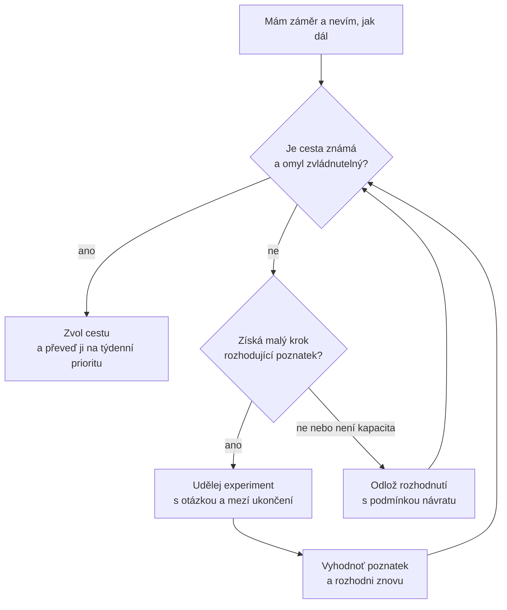

# Strategická revize

**Co tím vyřešíte:** rozhodnete, zda současný směr ponechat, upravit taktiku, vyzkoušet experiment, nebo přehodnotit strategii. **Kdy:** při opakujícím se nesouladu, po ukončení experimentu nebo po trvalé změně okolností; obvykle 20–30 minut. **Vstupy:** pozorování posledních týdnů, zvolená cesta a zamýšlený výsledek (pokud je máte), přehled závazků, odhad kapacity. **Předpoklady:** nepotřebujete formulář, skóre ani nový plán.

## Postup

1. **Oddělte pozorování od výkladu (5 minut).** Napište, co se stalo, bez soudu. Zvlášť připojte svůj výklad a míru jistoty. „Dvakrát jsem hovor odložila“ je pozorování; „na to nemám povahu“ je výklad.
2. **Určete, kde nesoulad vznikl (5 minut).** Šlo o konkrétní den a okolnosti (operativa)? Opakuje se to v týdnech a nevejde se to do kapacity (taktika)? Selhává předpoklad, na kterém stojí cesta (strategie)? Přestává být jasné, o co jde (hodnoty)?
3. **Ověřte kapacitu dřív než směr (5 minut).** Když povinnosti spotřebovaly celý týden nebo měsíc, změňte rozsah, odložte s podmínkou nebo přejednejte závazek. Nedostatek kapacity není důkaz chybné strategie.
4. **Zvolte jeden typ změny (5 minut).**
   - **Ponechat:** pozorování cestě neodporuje, změníte jen další krok.
   - **Upravit taktiku nebo portfolio:** cesta platí, ale rozsah, pořadí nebo počet záměrů ne. Zmenšete rozsah nebo jeden záměr vyřaďte.
   - **Vyzkoušet experiment:** chybí poznatek, který jde získat malým krokem. Stanovte otázku a mez ukončení.
   - **Přehodnotit strategii:** předpoklad se nepotvrdil, okolnosti se trvale změnily, nebo cesta dlouhodobě neodpovídá hodnotě.
5. **Zachovejte existující závazky (3 minuty).** Změna strategie, cíle ani plánu závazek neruší. Co jste slíbili, platí, dokud se s dotčeným člověkem nedohodnete jinak. Odmítnutí nové žádosti je platná volba.
6. **Zapište důvod a spouštěč návratu (2 minuty).** Jedna věta, proč jste se tak rozhodli, a podmínka, kdy téma otevřete znovu. Bez toho se rozhodnutí přepisuje podle nálady dne.

## Volba při strategické nejistotě

Obrázek 1 — Volba mezi známou cestou, experimentem a vědomým odkladem. Týká se jen záměrů, u kterých skutečně volíte cestu. Běžná péče, odpočinek a existující závazky žádné takové rozhodnutí nepotřebují.

## Očekávaný výsledek

- jedno rozhodnutí: ponechat, upravit taktiku, experimentovat, nebo přehodnotit strategii,
- důvod rozhodnutí a spouštěč další revize,
- potvrzené závazky, které změna nezasáhla,
- případně jeden experiment s otázkou a mezí ukončení.

## Když to nefunguje

- **Strategii měníte každý týden:** použijte pravidlo opakování. Jeden den ani jeden týden neprokazuje chybu cesty. Zapište, co se musí stát, abyste ji otevřeli.
- **Strategii neměníte roky, i když se nedaří:** stanovte datum revize. Vyhýbání se rozhodnutí je také volba.
- **Cítíte selhání:** oddělte kapacitu od vnitřní překážky. Vyčerpání není nedostatek vůle a nevyžaduje novou strategii.
- **Závazky se hroutí:** řešte je dřív než směr. Strategie nemá nahradit přejednání s dotčeným člověkem.

## Související

- [Od hodnot k jednání](../tutorials/from-values-to-action.md) — celá cesta na jednom příkladu.
- [Týdenní plánování](weekly-planning.md) — taktická změna v praxi.
- [Strategická návaznost](../reference/strategic-bridge.md) — horizonty, invarianty a meze.
