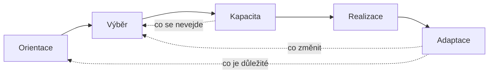

# Provozní jádro PLOS

**Typ dokumentu:** reference • **Stav:** návrh pro Iteration 3A; podklad k revizi vlastníkem, nikoli schválená architektura • **Rozsah:** provozní pohled na SS-01 až SS-06

Provozní jádro popisuje pět funkcí, které člověk potřebuje k běžnému rozhodování: orientaci, výběr, kapacitu, realizaci a adaptaci. Není to nový subsystém ani nový doménový model. Je to zjednodušený pohled na existující odpovědnosti a významy.

Uživatel nemusí znát všechny doménové pojmy ani jejich anglické názvy, aby podle jádra plánoval. Názvy v závorkách slouží k dohledání v autoritativních dokumentech.

## Co jádro je a co není

- Je to nejmenší sada otázek a výstupů, která umožní rozhodnout se a jednat.
- Není to povinný postup pro každodenní použití ani pět samostatných evidencí.
- Není to algoritmus priorit, model stavů ani návrh aplikace.

## Pět funkcí

Obrázek 1 — Pět funkcí a tři zpětné vazby. Šipky popisují návaznost rozhodnutí, ne časový tok ani automatické řízení.

| Funkce | Vstupy | Rozhodovací otázky | Výstupy |
| --- | --- | --- | --- |
| Orientace | Závazky, potřeby péče, termíny, hodnoty a směr, změny okolností, poznatky z reflexe | Co je právě důležité a proč? Co se zanedbáním zhorší? Co je pevné a co jen možnost? | Krátký seznam důležitého s důvodem; rozlišení závazku, projektu a možnosti |
| Výběr | Výstup orientace, kandidátní záměry, všechny známé nároky včetně těch, které nelze odmítnout | Čemu se věnovat? Co odložit a s jakým důvodem? Co se současně nevejde? | Jeden až dva záměry, vědomé odklady s důvodem, potvrzené závazky |
| Kapacita | Zvolené záměry, závazky, skutečný čas a energie, pevné body, zkušenost | Co se vejde? Kde jsou neslučitelné nároky? Co je nejisté? Jaká rezerva zůstane? | Realistický rozsah, pojmenované konflikty, rezerva, rozhodnutí o zmenšení či odkladu |
| Realizace | Zvolený rozsah, další kroky, aktuální kontext a energie | Jaký je další konkrétní krok a jeho podmínky? Jednat, odpočívat, nebo rozhodnout? | Provedený krok nebo vědomá volba nejednat; pozorování; nový krok |
| Adaptace | Pozorování, původní zamýšlené výsledky, nejistoty, subjektivní zkušenost | Co se stalo? Co z toho vyvozuji a co nevím? Co změnit? | Pozorování oddělené od interpretace, jedno rozhodnutí, podněty pro orientaci a výběr |

Funkce vycházejí z existujících odpovědností: Orientace ze SS-01 a SS-03, ve strategickém rozsahu také SS-02; Výběr ze SS-03; Kapacita ze SS-04; Realizace ze SS-05; Adaptace ze SS-06. Toto mapování je provozní zkratka, ne nová alokace odpovědností.

## Návaznost a volitelnost

- Nezbytná cesta je Orientace → Výběr → Kapacita → Realizace. Adaptace uzavírá smyčku.
- Pořadí je výchozí, ne jednosměrné. Když se zvolené záměry nevejdou, vrací Kapacita Výběr k novému rozhodnutí.
- Pro jeden den je Adaptace volitelná. Pro učení v horizontu týdne nebo delšího období je nezbytná.
- Začít lze kdekoliv. Při akutní povinnosti začněte Realizací a orientaci doplňte, až na ni bude čas.
- Volitelné jsou psaný záznam, explicitní hodnoty a vize, strategie, scénáře, projekty, metriky, číselný odhad kapacity i pravidelná kadence.
- Kapacita nemusí být číslo. Když chybí společná jednotka, posuzuje se slovně.

## Rozhodovací pravidla

1. Závazek nevzniká zápisem na seznam, doporučením ani zařazením do plánu. Vzniká přijetím odpovědnosti nebo existující povinností (INV-02).
2. Priorita nepřidává čas ani energii. Neslučitelné nároky zůstanou konfliktem, dokud se nezmění rozsah, podmínky nebo dostupnost (INV-16).
3. Plán je revidovatelná hypotéza. Skutečnost se nepřepisuje a změna plánu není důkaz splnění (INV-04).
4. Neznámé zůstává neznámé. Neznámý údaj není nula, neomezenost ani prokázané splnění (INV-11).
5. Nesouměřitelné zdroje se nesčítají. Bez společné jednotky a horizontu lze mluvit o omezení, ne o součtu (INV-13).
6. Souhrnný nárok (Resource Demand) a jeho části se v jednom posouzení nepočítají dvakrát (INV-14, INV-15).
7. Dokončená práce neprokazuje dosažení zamýšleného výsledku (INV-05).
8. Změna směru, cíle, projektu ani plánu sama neruší závazek (INV-06).
9. Nevyplněná kapacita je platný výsledek. Odpočinek nepotřebuje projekt ani zdůvodnění (ADR-04).
10. Odmítnutí doporučení je platné rozhodnutí (P1).

## Nedostatek kapacity

Když je kapacita menší než nároky, použijte v tomto pořadí:

1. Zmenšete rozsah. Menší výsledek je platný; stejný výsledek v menším čase obvykle ne.
2. Odložte s konkrétním spouštěčem („po termínu X“, „v týdnu, kdy…“), ne obecně „někdy“.
3. Přejednejte závazek s dotčenou stranou. Dohoda mění podmínky; tichý úmysl je nemění.
4. Přiznejte, že to nejde. Nevyřešený konflikt je platný stav poznání.
5. Chraňte regeneraci. Vyčerpání není kapacita.

Nedělejte toto: nezvyšujte prioritu místo snížení rozsahu, neslibujte dohnání, neoznačujte nesplněné za splněné a nevytvářejte dluh, který lze jen „dořešit“.

## Existující závazky

- Závazky platí dál, i když je přestanete sledovat. Přestat sledovat není splnit.
- Na začátku Orientace a Kapacity zkontrolujte závazky s blízkým termínem nebo dopadem na druhé.
- Odklad závazku je samostatné rozhodnutí s důvodem. Změna projektu, cíle či strategie ho neruší (INV-06).
- Závazek může skončit splněním, platným přejednáním nebo jiným skutečným zánikem odpovědnosti. Samotný úmysl nestačí.
- Běžný závazek nepotřebuje strategický cíl ani projekt (INV-07).

## Tři úrovně používání

Úrovně jsou **návrhové hypotézy**, nikoli schválená architektura. Nejde o totéž jako provozní režimy OP-01 až OP-07 v ConOps: „režim“ tam označuje situaci a účel, „úroveň používání“ zde označuje rozsah provozního jádra.

| Úroveň | Kdy ji použít | Funkce a rozsah | Typický čas | Co nevyžaduje |
| --- | --- | --- | --- | --- |
| Minimální (Minimal Mode) | přetížení, nemoc, krize, návrat po pauze | Orientace v rozsahu „co dnes nesmím minout“, Výběr jedné věci, Realizace jednoho kroku; Kapacita slovně; Adaptace není nutná | 1–5 minut denně | historii, plán, kategorizaci, zápis |
| Standardní (Standard Mode) | běžný týden | denně všech pět funkcí v krátké formě; týdně Orientace, Výběr, Kapacita a Adaptace v širším rozsahu | 5 minut denně, 20–30 minut týdně | aplikaci, metriky, strategii |
| Rozšířená (Extended Mode) | změna směru, experiment, větší rozhodnutí | všechny funkce a navíc scénáře, předpoklady a podrobnější review | nárazově | formální model, skórování |

Pravidla přepínání:

- Všechny úrovně používají stejný významový základ. Závazek, další krok, kapacita ani pozorování nemají na jiné úrovni jiný význam.
- Přepnutí nesmí zrušit závazek ani vytvořit administrativní dluh.
- Návrat začíná současným stavem. Starý plán je podklad k přehodnocení, ne seznam k dohnání.
- Rozšířená úroveň není „vyšší“ ani povinný cíl. Volba úrovně patří člověku.

## Vztah k frameworkům

| Framework | Přirozená funkce | Co jádro přebírá | Co nepřebírá |
| --- | --- | --- | --- |
| ACT | Orientace | hodnoty jako směr jednání, ne dokončitelný cíl | terapeutický protokol |
| Designing Your Life | Orientace, Výběr | alternativní scénáře a malé experimenty před velkým závazkem | povinný počet scénářů |
| 12 Week Year | Výběr, Kapacita | návaznost horizontů a pravidelný rytmus | pevný dvanáctitýdenní cyklus a výkonové skóre |
| GTD | Realizace | zachytit, vyjasnit a určit další krok | povinnou evidenci a nástroje |
| Kanban | Výběr, Kapacita | viditelnost souběhu a omezení rozpracovanosti | univerzální limit WIP a povinnou vizuální aplikaci |
| WOOP | Realizace | vnitřní překážku a podmíněnou reakci | ztotožnění kapacitního omezení s vnitřní překážkou |

Tabulka uvádí, kde se framework přirozeně uplatní. Neznamená, že PLOS přebírá celou metodu nebo že integrace byla ověřena.

## Meze a otevřené otázky

- Jádro neobsahuje algoritmus priorit, číselné limity, metriky ani stavové automaty. Ty patří do pozdějších kroků (OQ-01, OQ-02, OQ-03).
- Sdílení, delegace a přístup dalších osob nejsou navrženy (OQ-07).
- Jádro je vykonatelné bez softwaru a bez záznamu. Zápis může rozhodování podpořit, ale není podmínkou.

## Autoritativní zdroje

- [GLO-01 — slovník](../../glossary.md): definice pojmů Commitment, Next Action, Capacity, Review a dalších.
- [DOM-01 — doménový model](../../03-architecture/preliminary-domain-model.md): identita, vztahy a invarianty.
- [ARCH-01 — konceptuální architektura](../../03-architecture/conceptual-architecture.md): odpovědnosti SS-01 až SS-06.
- [CO-01 — Concept of Operations](../../01-foundations/concept-of-operations.md): provozní režimy OP-01 až OP-07.
- [ADR — rozhodnutí](../../05-decisions/decision-log.md): ADR-03, ADR-04 a ADR-10.
