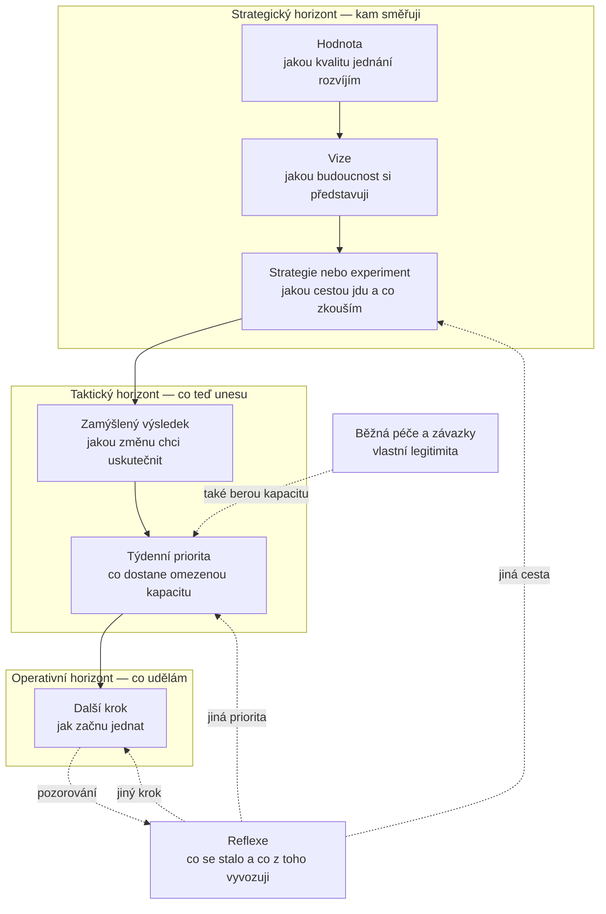

# Od hodnot k jednání

**Typ dokumentu:** tutorial • **Čas:** přibližně 25–30 minut • **Pomůcky:** papír a pero • **Výsledek:** jeden týdenní krok, který vychází z vědomého směru

Tento tutorial vás provede cestou od hodnoty k jednomu kroku. Používá jediný fiktivní příklad; potom stejné otázky zopakujte se svou situací. Nepotřebujete znát architekturu PLOS ani mít hotový strategický plán.

Jana je účetní, má dvě děti a bydlí v menší obci. Následující kroky jsou ilustrativní, ne doporučený životní styl.

## Krok 1 — Pojmenujte hodnotu (5 minut)

Hodnota je kvalita jednání, kterou chcete rozvíjet průběžně. Není to cíl, který lze dokončit nebo odškrtnout. Zeptejte se: Jakým člověkem chci být ve vztahu k druhým? Kdy se tak už chovám?

Jana si zapíše: „Chci si všímat lidí kolem sebe a pomáhat jim cítit se méně sami.“ Všimne si, že tuto hodnotu už žije, když se zastaví u sousedky. Nemusí kvůli tomu mít projekt.

Hodnota sama neříká, co udělat. Dává směr a měřítko, podle kterého poznáte, zda vám volba sedí.

## Krok 2 — Popište žádoucí budoucnost (5 minut)

Vize je představa žádoucího stavu za delší dobu. Je revidovatelná a nezavazuje vás k plánu. Zeptejte se: Jak by vypadal běžný týden, kdyby se hodnota dařila? Co by bylo jinak pro mě a pro druhé?

Jana napíše: „Za pět let chci, aby v naší obci fungovalo páteční posezení pro lidi nad 65 let, které pomůžu udržovat.“ Vize popisuje stav, ne cestu.

## Krok 3 — Zvolte cestu nebo experiment (5 minut)

Napište dvě možnosti a u každé odpovězte: Podporuje to hodnotu? Co tím vylučuji? Co se stane, když se to nepovede?

Jana zvažuje dvě cesty. První je založit klub hned a hledat prostory. Druhá je nejdřív zjistit, jestli o pravidelné setkávání vůbec stojí zájem. Druhá varianta je menší a rychleji ukáže, zda má smysl. Jana zvolí experiment s otázkou „přijde někdo opakovaně?“ a mezí ukončení: po třech rozhovorech a dvou zkušebních posezeních. Otázka o opakování potřebuje aspoň dvě setkání; jedno posezení ji nemůže vyhodnotit.

Experiment není závazek na roky. Když potřebujete hlavně poznatek, pojmenujte, kdy skončí.

## Krok 4 — Zvolte střednědobý výsledek (5 minut)

Střednědobý záměr je konkrétní změna, kterou do určitého data poznáte. Vyberte jeden a napište, podle čeho ho posoudíte. Horizont si určete sami; dvanáct týdnů není povinné.

Jana si zapíše: „Do konce listopadu vím, jestli o páteční posezení je zájem, a mám domluvený první termín.“ Obecné „oživím obec“ by nešlo posoudit.

## Krok 5 — Převeďte ho do týdenní priority (5 minut)

Podívejte se na skutečný týden: pevné body, energii a závazky. Priorita nepřidá čas. Co se vejde vedle toho, co už platí? Záměr z kroku 4 zůstává stejný; týdenní priorita jen rozhoduje, co z něj dostane kapacitu.

Janin týden: ve čtvrtek vozí dceru na plavání a matce slíbila nákup, v práci má uzávěrku do pátku. Volný je středeční večer a sobotní dopoledne.

Zvolí jednu prioritu: domluvit dva rozhovory. Nákup s matkou přesune na sobotu, ale nejdřív se domluví; dohoda mění závazek, samotný úmysl ne. Uzávěrku nechá být, ta má termín.

## Krok 6 — Určete další krok (3 minuty)

Další krok je konkrétní činnost s časem nebo podmínkou. Ne „udělám rozhovory“, ale „ve středu v 18:00 zavolám paní Dvořákové a zeptám se, kdo se v obci schází“.

Pojmenuje i vnitřní překážku: bojí se, že obtěžuje. Připraví si podmíněnou reakci: „Když budu otálet, pošlu nejdřív SMS.“ To je volitelné. Kdyby jí chyběl čas, protože hlídá nemocnou matku, nešlo by o vnitřní překážku, ale o kapacitu.

## Krok 7 — Projděte týden a reflektujte (5 minut)

Na konci týdne oddělte: co se stalo, co si o tom myslíte a co vyvodíte.

Jana poznamená: proběhl jeden rozhovor, druhý ne, zkušební posezení ne. Výklad: po 19. hodině nemá na telefon energii, jeden večer to ale neprokazuje. Rozhodne se přesunout hovory na sobotní dopoledne a zmenšit první posezení na čtyři lidi.

Změnila taktiku, ne strategii ani hodnotu. Kdyby se stejný vzorec opakoval i v dalších týdnech navzdory změně taktiky, otevře strategickou revizi: možná není problém v čase, ale v tom, že jí rozhovory nesedí. Počet týdnů je ilustrace, ne univerzální práh; rozhoduje trvání vzorce.

## Diagram: cesta od hodnoty k dalšímu kroku

Obrázek 1 — Tři horizonty a zpětná vazba. Šipky popisují návaznost rozhodnutí, ne časový tok. Běžná péče a závazky nevstupují do strategické cesty, ale spotřebovávají stejnou kapacitu.

## Jste hotovi, když…

- máte jednu hodnotu vyjádřenou jako kvalitu jednání,
- máte větu o žádoucí budoucnosti, nebo ji vědomě odkládáte,
- máte zvolenou cestu nebo experiment s otázkou a mezí ukončení,
- máte střednědobý výsledek, týdenní prioritu, další krok s časem nebo podmínkou a větu reflexe,
- umíte říct, co jste záměrně odložili.

## Když to nevyjde

- **Povinnosti spotřebují celý týden:** ponechte záměr a odložte ho s podmínkou („první týden, kdy nebudu mít uzávěrku“). Nedostatek kapacity není psychologické selhání a nevyžaduje novou strategii.
- **Nevíte, kterou cestu zvolit:** udělejte experiment, nebo rozhodnutí vědomě odložte s datem návratu. Odklad je platná volba.
- **Hodnota se nedá převést na krok:** je pravděpodobně příliš obecná. Napište, jak vypadá v jedné konkrétní situaci.
- **Záměr vás přestal bavit:** je to podnět k revizi, ne důkaz selhání. Podívejte se, zda selhává cesta, nebo zda se změnilo to, co je pro vás důležité.
- **Chcete přeskočit rovnou na krok:** můžete. Strategie není podmínkou použití PLOS; k orientaci se vraťte, až bude potřeba.

## Další krok

- [Strategická revize](../how-to/strategic-review.md) — kdy cestu změnit a kdy ne.
- [Týdenní plánování](../how-to/weekly-planning.md) — týdenní priorita v běžném týdnu.
- [Strategická návaznost](../reference/strategic-bridge.md) — pravidla a meze propojení.
